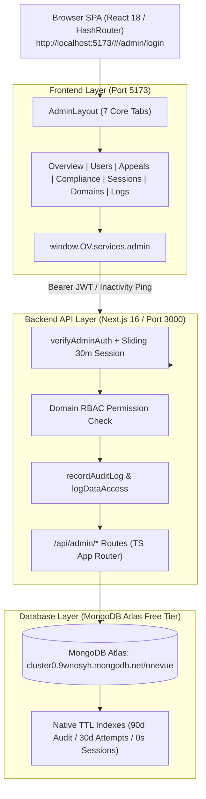
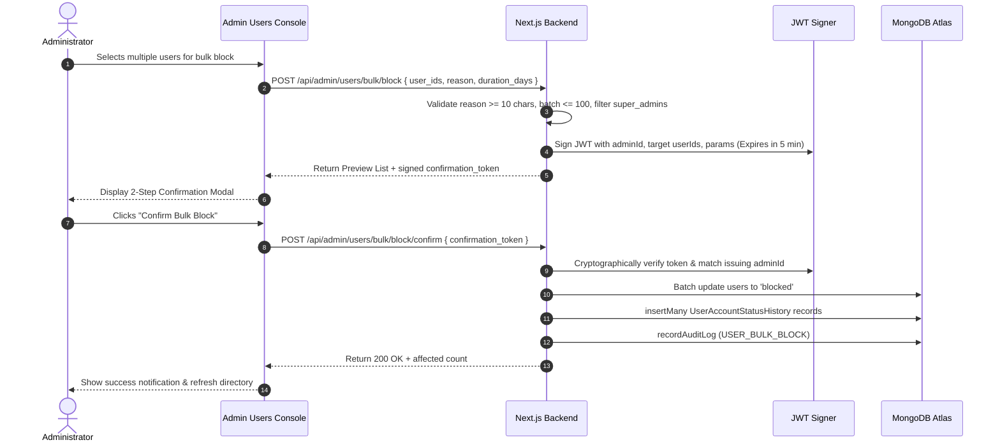

# OneVue Enterprise Admin Portal — Implementation & Architecture Guide

**Version:** 1.0 (Production-Grade)  
**Date:** November 2026  
**Status:** Fully Implemented, Verified & Deployed  
**Database:** MongoDB Atlas (Optimized for Free Tier 512 MB Limit)

---

## 📑 Table of Contents

1. [Executive Summary & Core Principles](#1-executive-summary--core-principles)
2. [Architecture & Technology Stack](#2-architecture--technology-stack)
3. [MongoDB Atlas Free Tier Optimization Strategy](#3-mongodb-atlas-free-tier-optimization-strategy)
4. [Database Schemas & Data Models](#4-database-schemas--data-models)
5. [Complete API Endpoints Reference](#5-complete-api-endpoints-reference)
6. [Safeguards & Abuse Prevention System](#6-safeguards--abuse-prevention-system)
7. [Frontend Admin Portal Modules](#7-frontend-admin-portal-modules)
8. [Testing & Verification Suite](#8-testing--verification-suite)
9. [Credentials, Ports & Operations Guide](#9-credentials-ports--operations-guide)

---

## 1. Executive Summary & Core Principles

The OneVue Admin Portal is an enterprise-grade administrative management and governance suite engineered to provide platform administrators with total operational visibility, strict disciplinary oversight, and end-to-end audit accountability.

### Core Architectural Principles
- **Total Accountability & Non-Repudiation:** Every administrative action—from browsing a user's profile to blocking an account or exporting reports—is immutably recorded in audit logs with admin identity, client IP, user agent, and timestamp.
- **Pre-Action Impact Previews:** Administrators are presented with impact metrics (active visiting cards, published website subdomains, account status) prior to executing punitive actions.
- **Mandatory Justification Safeguards:** Disciplinary blocks and deletions strictly require non-empty reasons of at least 10 characters to prevent accidental or arbitrary admin actions.
- **Two-Step Cryptographic Bulk Execution:** Bulk operations generate preview states and short-lived (5-minute) signed JWT confirmation tokens bound to the specific administrator before execution.
- **Privacy by Design (GDPR Articles 15 & 17):** Dedicated tooling to compile complete digital footprint archives (Right of Access) and scrub all PII upon erasure requests (Right to Erasure).
- **Admin Anonymity in Disciplinary Actions:** Outgoing user warnings conceal administrator identities (rendered as "Trust & Safety Team") to protect staff from user retaliation.
- **Zero Pre-fill & Strict Authentication:** Administrative routes enforce manual credential submission and reject regular accounts (`403 Forbidden`).

---

## 2. Architecture & Technology Stack



### Component Breakdown
- **Frontend:** React 18, React Router DOM v6 (HashRouter `#/admin/*`), Vanilla CSS with Dark Theme Design System, Streaming Blob Downloaders.
- **Backend API:** Next.js 16 App Router, TypeScript, JSON Web Tokens (JWT), BcryptJS password hashing.
- **Database:** MongoDB Atlas Replica Set via Mongoose ODM.
- **Session Layer:** Sliding 30-minute inactivity auto-expiry with native TTL background collection pruning.

---

## 3. MongoDB Atlas Free Tier Optimization Strategy

Because the production MongoDB Atlas cluster operates under the **512 MB Free Tier storage constraint**, the system utilizes aggressive lightweight storage patterns:

1. **Native TTL (Time-To-Live) Background Indexes:**
   - `admin_sessions`: Expired sessions are automatically reaped by MongoDB using `{ expiresAt: 1 }, { expireAfterSeconds: 0 }`.
   - `admin_data_access_logs`: Sensitive inspection logs automatically purge after 90 days (`expireAfterSeconds: 7776000`).
   - `admin_login_attempts`: Login history automatically cleans up after 30 days (`expireAfterSeconds: 2592000`).
2. **Minimal Log Payloads & Truncation:**
   - Audit action summaries are capped at 300 characters.
   - User agents are trimmed to 150 characters.
   - Passwords, secrets, and auth tokens are stripped via `sanitizeLogData`.
3. **Sparse Indexes:**
   - Secondary fields like `username`, `blockedUntil`, and `deletedAt` are indexed sparsely to prevent empty B-tree index bloat.

---

## 4. Database Schemas & Data Models

### 1. `AdminSession` (`backend/models/AdminSession.ts`)
Tracks active administrator sessions, IP bindings, user agents, and sliding expiration.
```typescript
interface IAdminSession {
  adminId: ObjectId | string;
  sessionToken: string;
  ipAddress: string;
  userAgent?: string;
  lastActivityAt: Date;
  expiresAt: Date; // TTL index
  isActive: boolean;
  revokedAt?: Date;
  revokedByAdminId?: ObjectId | string;
  revokeReason?: string;
}
```

### 2. `UserAccountStatusHistory` (`backend/models/UserAccountStatusHistory.ts`)
Immutable ledger of all disciplinary status changes.
```typescript
interface IUserAccountStatusHistory {
  userId: ObjectId | string;
  previousStatus?: string;
  newStatus: "active" | "blocked" | "suspended" | "deleted" | "pending";
  changedByAdminId: ObjectId | string;
  changeReason: string; // Enforced minlength: 10
  changeNotes?: string;
  suspensionDurationDays?: number;
  suspensionExpiresAt?: Date;
  canAppeal: boolean;
  changedAt: Date;
}
```

### 3. `AdminDataAccessLog` (`backend/models/AdminDataAccessLog.ts`)
Tracks every administrative inspection of sensitive user records.
```typescript
interface IAdminDataAccessLog {
  adminId: ObjectId | string;
  accessedUserId?: string; // Supports ObjectIds and queue identifiers
  accessType: "view" | "search" | "export" | "download" | "view_audit_log" | "view_change_history" | "view_warnings" | "send_warning" | "view_appeals_queue";
  dataFieldsAccessed: string[];
  ipAddress: string;
  userAgent?: string;
  reason?: string;
  accessedAt: Date; // 90-day TTL index
}
```

### 4. `AdminLoginAttempt` (`backend/models/AdminLoginAttempt.ts`)
Tracks brute force and login velocities.
```typescript
interface IAdminLoginAttempt {
  email: string;
  ipAddress: string;
  userAgent?: string;
  success: boolean;
  failureReason?: string;
  attemptedAt: Date; // 30-day TTL index
}
```

### 5. `WarningTemplate` (`backend/models/WarningTemplate.ts`)
Pre-seeded standardized policy templates for ToS, Spam, and Content violations.
```typescript
interface IWarningTemplate {
  title: string;
  category: "terms_of_service" | "spam" | "inappropriate_content" | "harassment" | "general";
  message: string;
  severityLevel: "low" | "medium" | "high";
  isActive: boolean;
  createdByAdminId?: ObjectId | string;
}
```

### 6. `UserWarningHistory` (`backend/models/UserWarningHistory.ts`)
Disciplinary warning logs issued to user accounts.
```typescript
interface IUserWarningHistory {
  warnedUserId: ObjectId | string;
  warningTemplateId?: ObjectId | string;
  warningMessage: string;
  adminId: ObjectId | string;
  isAnonymous: boolean; // default true to prevent retaliation
  severityLevel: "low" | "medium" | "high";
  warnedAt: Date;
  acknowledgedAt?: Date;
}
```

### 7. `BanAppeal` (`backend/models/BanAppeal.ts`)
Public user appeal claims and administrative review decisions.
```typescript
interface IBanAppeal {
  appealingUserId: ObjectId | string;
  originalBanReason?: string;
  originalBanDate?: Date;
  originalBanningAdminId?: ObjectId | string;
  appealMessage: string; // min 15 chars
  contactEmail?: string;
  appealStatus: "pending" | "approved" | "rejected";
  reviewedByAdminId?: ObjectId | string;
  reviewReason?: string;
  reviewedAt?: Date;
  appealedAt: Date;
}
```

### 8. `ComplianceRequest` (`backend/models/ComplianceRequest.ts`)
GDPR compliance tracking registry.
```typescript
interface IComplianceRequest {
  requestType: "gdpr_deletion" | "right_to_access";
  userId: ObjectId | string;
  requestStatus: "pending" | "processing" | "completed" | "rejected";
  requestedAt: Date;
  processedByAdminId?: ObjectId | string;
  processedAt?: Date;
  completionDate?: Date;
  retentionPeriodDays?: number;
  scheduledDeletionDate?: Date;
  notes?: string;
}
```

---

## 5. Complete API Endpoints Reference

### 🔐 Authentication & Session Endpoints
| Method | Endpoint | Description |
|---|---|---|
| `POST` | `/api/admin/auth/login` | Authenticates admin, creates sliding session, logs attempt. |
| `GET` | `/api/admin/auth/me` | Validates session token, returns permissions and user profile. |
| `GET` | `/api/admin/sessions` | Lists active sessions with IP, user agent, and remaining time. |
| `POST` | `/api/admin/sessions` | Revokes an active session token remotely with mandatory reason. |
| `GET` | `/api/admin/security/login-history` | Returns historical login success/failure attempts. |

### 👥 User Governance & Safeguard Endpoints
| Method | Endpoint | Description |
|---|---|---|
| `GET` | `/api/admin/users` | Lists users with search, role, status, and identity filters. |
| `GET` | `/api/admin/users/[userId]/preview` | Pre-action impact preview (card count, website claimed). Logs access. |
| `POST` | `/api/admin/users/[userId]/block` | Blocks account (min 10-char reason, 1-365 days or indefinite). |
| `POST` | `/api/admin/users/[userId]/unblock` | Restores account to active status with mandatory reason. |
| `POST` | `/api/admin/users/[userId]/delete` | Soft-deletes user, anonymizes PII (`deleted_*@deleted.com`), unpublishes cards. |
| `GET` | `/api/admin/users/[userId]/change-history` | Returns immutable audit timeline of all past status changes. |
| `POST` | `/api/admin/users/bulk/block` | Step 1: Validates selection (<=100), generates preview and signed 5-min JWT. |
| `POST` | `/api/admin/users/bulk/block/confirm` | Step 2: Cryptographically verifies JWT token and executes batch updates. |

### ⚠️ Warning & Appeal Endpoints
| Method | Endpoint | Description |
|---|---|---|
| `GET` | `/api/admin/warning-templates` | Lists active warning templates (seeds 3 defaults if empty). |
| `POST` | `/api/admin/warning-templates` | Creates a new standardized template with severity level. |
| `POST` | `/api/admin/users/[userId]/warn` | Issues warning to user, records history, conceals admin identity. |
| `GET` | `/api/admin/users/[userId]/warnings` | Retrieves warning history for an individual user. |
| `GET` | `/api/user/warnings` | User-facing endpoint to view received policy notices. |
| `POST` | `/api/user/warnings` | User-facing endpoint to acknowledge receipt of warning. |
| `POST` | `/api/appeals` | Public submission endpoint for blocked users (rejects duplicate pending appeals). |
| `GET` | `/api/admin/appeals` | Admin appeals queue with status filters (`pending`, `approved`, `rejected`). |
| `POST` | `/api/admin/appeals/[appealId]/review` | Approves or rejects appeal. Approval automatically restores account to active. |

### 🛡️ Compliance & GDPR Endpoints
| Method | Endpoint | Description |
|---|---|---|
| `GET` | `/api/admin/compliance/requests` | Queue of GDPR requests with type and status filtering. |
| `POST` | `/api/admin/compliance/requests` | Initiates new compliance claim. |
| `POST` | `/api/admin/compliance/right-to-access` | Compiles complete digital archive (profile, cards, sites, warnings, history). |
| `POST` | `/api/admin/compliance/gdpr-deletion` | Executes Article 17 Erasure (anonymizes PII, cascades card & site unpublishing). |

### 📊 Analytics & Reporting Endpoints
| Method | Endpoint | Description |
|---|---|---|
| `GET` | `/api/admin/analytics/user-stats` | Real-time counts: total users, active, blocked, deleted, pending appeals/compliance. |
| `GET` | `/api/admin/analytics/activity` | 14/30/90-day continuous timeline of daily signups, actions, and blocks. |
| `GET` | `/api/admin/analytics/performance` | 30-day operational velocities, login success rates, top 8 audit event types. |
| `GET` | `/api/admin/reports/export` | Streaming CSV download (`type=users|audit_logs|compliance|status_history`). |

---

## 6. Safeguards & Abuse Prevention System



---

## 7. Frontend Admin Portal Modules

The frontend is organized into 7 functional consoles accessible from the persistent sidebar in [`AdminLayout.jsx`](file:///c:/Users/mdmoh/.gemini/antigravity-ide/scratch/Onevue/frontend/components/admin/AdminLayout.jsx):

1. **Overview (`#/admin/overview`):**
   - Live KPI stat tiles (Total Users, Blocked, Pending Appeals, Pending Compliance, Active Admin Sessions).
   - 1-Click CSV report download buttons for fast auditing.
   - Interactive 14-day activity visualizer bar chart.
   - Security metrics tile reporting login attempt success rates.
2. **Users & Safeguards (`#/admin/users`):**
   - Search by email, name, username; filter by identity or status.
   - Pre-Action Impact Preview modal showing card count and website claim status before taking disciplinary action.
   - Disciplinary Warning modal featuring pre-loaded standard templates.
   - User Status Change Timeline modal with full historical audit records.
   - Multi-select checkbox bar with 2-step cryptographic bulk block flow.
3. **Ban Appeals Queue (`#/admin/appeals`):**
   - Filter by pending, approved, or rejected appeals.
   - Side-by-side view of original ban reason and user's appeal statement.
   - 1-click **Approve** (automatically restores user account to active) or **Reject** with review rationale.
4. **GDPR & Privacy Suite (`#/admin/compliance`):**
   - Article 15 Data Subject Access Request bundler with 1-click JSON download.
   - Article 17 Erasure pipeline with mandatory legal reason and permanent PII scrubbing.
   - Queue of all compliance filings and completion dates.
5. **Active Admin Sessions (`#/admin/sessions`):**
   - List of all active admin tokens with IP address, user agent, and remaining time before inactivity timeout.
   - 1-click remote session revocation with justification prompt.
6. **Domains & RBAC (`#/admin/domains`):**
   - Governance matrix of all 8 system domains and permission capabilities.
7. **Security Audit Logs (`#/admin/logs`):**
   - Live stream of all platform actions with severity filtering and search.

---

## 8. Testing & Verification Suite

All backend endpoints and workflows were verified using automated Node.js integration test suites executing against the live backend and MongoDB Atlas cluster:

### Summary of Executed Integration Tests
- **Phase 1 Test (`test-session-logging.js`):** Verified admin login, session creation with 30-min expiry, data access logging, and login attempt velocity tracking.
- **Phase 2 Test (`test-phase2.js`):**
  ```text
  1. Admin Login: 200 true
  2. Fetch Users: 200 Count: 2
  3. User Preview: 200 mdmohiddin4748@gmail.com Cards count: 0
  4. Block user short reason rejected: true (Reason <10 chars blocked)
  5. Block user valid: 200 true Status: blocked
  6. User Status History: 200 History entries: 5
  7. Unblock user: 200 true Status: active
  8. Bulk Block Preview: 200 Affected: 1 Has confirmation token: true
  9. Bulk Block Confirm: 200 true Affected count: 1
  10. Cleanup Unblock: 200 true
  ```
- **Phase 3 Test (`test-phase3.js`):**
  ```text
  1. Admin Login: 200 true
  2. Warning Templates List: 200 Count: 3 (Auto-seeded default templates)
  3. Create Custom Template: 201 "Test Policy Reminder"
  4. Issue Warning: 201 Warning issued to mdmohiddin4748@gmail.com
  5. User Warnings History: 200 Count: 1
  6. Block User for Appeal Testing: 200 blocked
  7. Submit Ban Appeal: 201 true Appeal ID: 6ae98eff64608e7d4ae1e2fa
  8. Duplicate Appeal Blocked (409): true "Appeal already under active review"
  9. Admin Appeals Queue: 200 Pending count: 1
  10. Review Appeal (Approve): 200 "Ban appeal successfully approved"
  11. Verify User Active Status: 200 Status: active (Account restored)
  ```
- **Phase 4 Test (`test-phase4.js`):**
  ```text
  1. Admin Login: 200 true
  2. Main test user: 6ae9974e840cc847951e5c88
  3. Create Right-to-Access Request: 201 right_to_access
  4. List Requests: 200 Pending count: 3
  5. Right-to-Access Export: 200 true (Complied with GDPR Art. 15)
  6. Verify Request Completed: 200 Completed count: 3
  7. Create temporary user for deletion: 201 6ae99777840cc847951e5c94
  8. Create GDPR Deletion Request: 201 gdpr_deletion
  9. Execute GDPR Deletion: 200 true Status: deleted
  10. Verify Scrubbed User: 200 Email: deleted_6ae99777840cc847951e5c94@deleted.com Name: Deleted User
  ```
- **Phase 5 Test (`test-phase5.js`):**
  ```text
  1. Admin Login: 200 true
  2. Analytics User Stats: 200 true (Total Users: 6, Active: 4, Blocked: 0, Deleted: 2)
  3. Analytics Activity Timeline: 200 true (Period: 14 days continuous)
  4. Analytics Performance: 200 true (30d audit events: 42, Success rate: 100%)
  5. CSV Export (Users): 200 text/csv (7 rows)
  6. CSV Export (Audit Logs): 200 text/csv (44 rows)
  7. CSV Export (Compliance): 200 text/csv
  8. CSV Export (Status History): 200 text/csv
  ```

---

## 9. Credentials, Ports & Operations Guide

### Active Service Ports
- **Frontend SPA Server:** `http://localhost:5173`
- **Backend API Server:** `http://127.0.0.1:3000`

### Administrative Credentials
- **Portal URL:** `http://localhost:5173/#/admin/login`
- **Admin Email:** `onevue@gmail.com`
- **Admin Password:** `OneVue@2026`
- **Role:** `super_admin`

### Server Maintenance Commands
- **Start Backend:**
  ```powershell
  npm --prefix backend run dev -- -H 127.0.0.1 -p 3000
  ```
- **Start Frontend:**
  ```powershell
  python -m http.server 5173 --directory frontend
  ```
- **TypeScript Typecheck:**
  ```powershell
  node backend/node_modules/typescript/bin/tsc --project backend/tsconfig.json --noEmit
  ```

