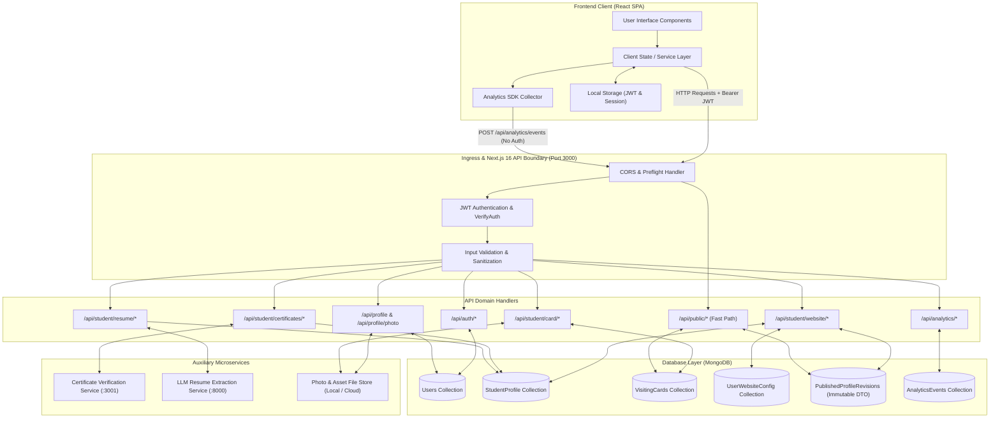
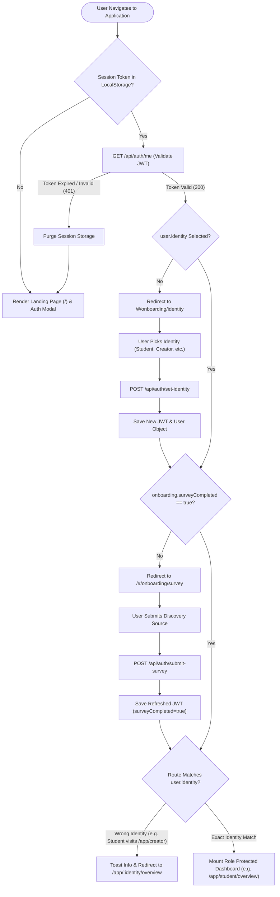
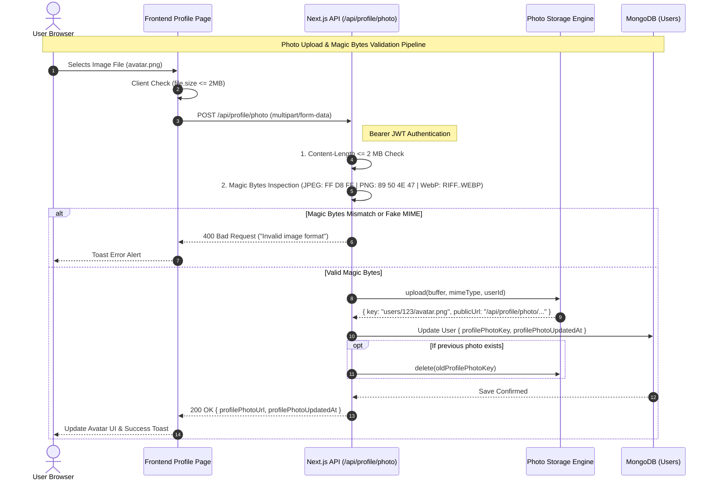
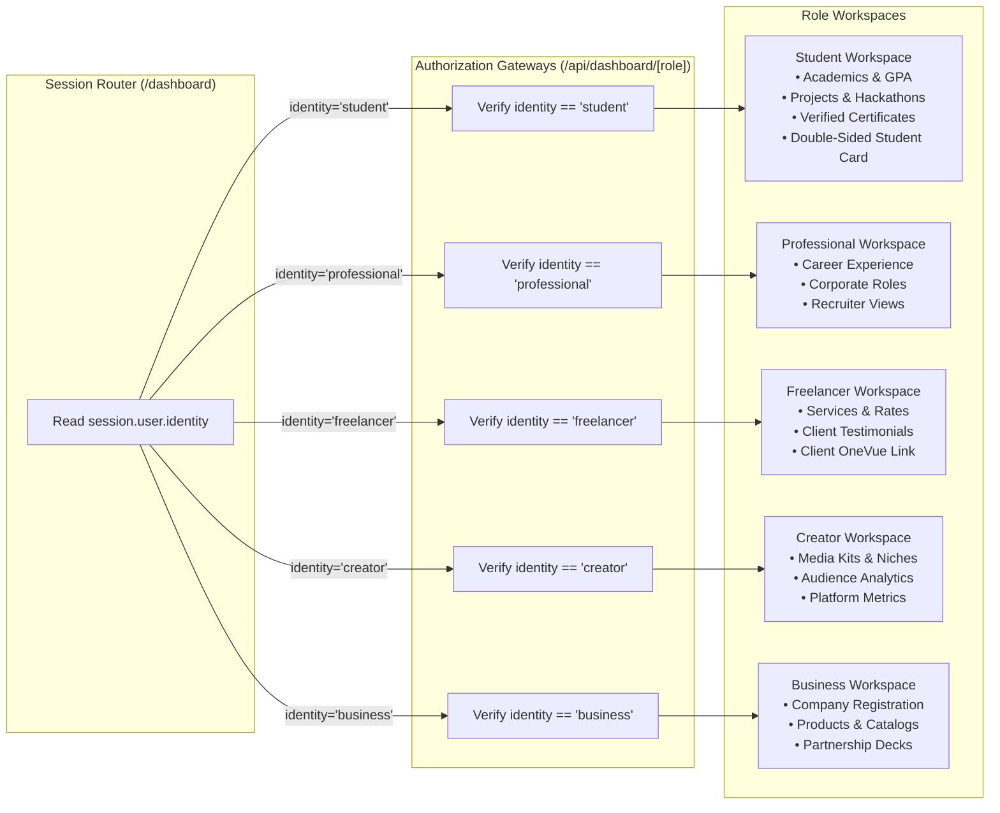
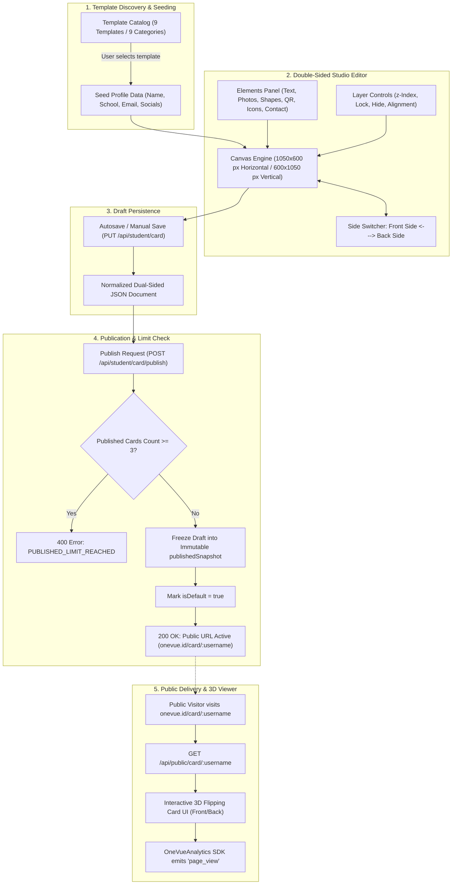
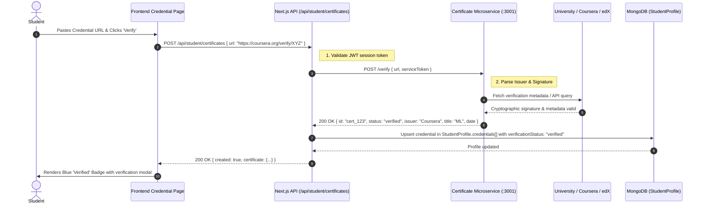
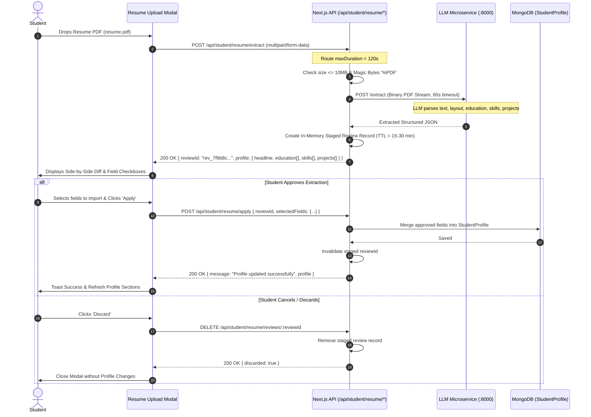
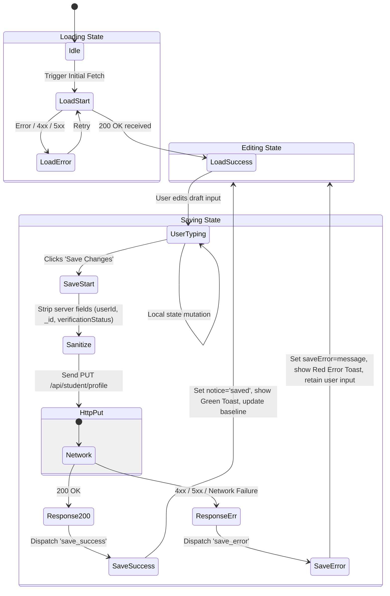

# OneVue — Complete Backend Pipeline Architecture Flowchart & Visual Design Guide

> **Document Type:** Visual Architecture & Engineering Flowcharts  
> **Target Audience:** Frontend Developers, System Architects & UI/UX Engineers  
> **Companion Document:** [BACKEND_ARCHITECTURE_FRONTEND_SPEC.md](file:///c:/Users/srivv/Downloads/Telegram%20Desktop/company_project/docs/BACKEND_ARCHITECTURE_FRONTEND_SPEC.md)  
> **Status:** Production Reference  

---

## Table of Contents

1. [Master System Architecture & Dataflow Flowchart](#1-master-system-architecture--dataflow-flowchart)
2. [Authentication, Onboarding & Route Guard Flowchart](#2-authentication-onboarding--route-guard-flowchart)
3. [Core Profile & Media Asset Upload Flowchart](#3-core-profile--media-asset-upload-flowchart)
4. [Multi-Domain Tenancy & Workspace Routing Flowchart](#4-multi-domain-tenancy--workspace-routing-flowchart)
5. [Canva-Style Visiting Card Studio Pipeline Flowchart](#5-canva-style-visiting-card-studio-pipeline-flowchart)
6. [Website & Portfolio Publishing & Rollback Pipeline Flowchart](#6-website--portfolio-publishing--rollback-pipeline-flowchart)
7. [Digital Certificate Verification Microservice Sequence Flowchart](#7-digital-certificate-verification-microservice-sequence-flowchart)
8. [Resume AI Extraction & Review Staging Sequence Flowchart](#8-resume-ai-extraction--review-staging-sequence-flowchart)
9. [Analytics Ingestion & Reporting Dual-Pipeline Flowchart](#9-analytics-ingestion--reporting-dual-pipeline-flowchart)
10. [Frontend Service Layer & Reducer State Transition Flowchart](#10-frontend-service-layer--reducer-state-transition-flowchart)

---

## 1. Master System Architecture & Dataflow Flowchart

This master diagram depicts the complete end-to-end topology connecting the React Frontend SPA, the Next.js 16 App Router backend, external microservices, and persistent databases.



---

## 2. Authentication, Onboarding & Route Guard Flowchart

Every user transitions through a strict 3-tier onboarding pipeline before gaining access to their role-specific dashboard.



---

## 3. Core Profile & Media Asset Upload Flowchart

This pipeline illustrates how user metadata (bio, username claiming) and binary images (profile photos) are validated and stored.



---

## 4. Multi-Domain Tenancy & Workspace Routing Flowchart

OneVue serves 5 distinct professional personas from a single code base with guaranteed tenant role isolation.



---

## 5. Canva-Style Visiting Card Studio Pipeline Flowchart

The Visiting Card pipeline supports dual-sided canvas editing, template seeding, multi-card duplication, and atomic publication with frozen snapshots.



---

## 6. Website & Portfolio Publishing & Rollback Pipeline Flowchart

Drafts in the website builder are completely isolated from public viewers until an atomic publication revision is committed.

```mermaid
sequenceDiagram
    autonumber
    actor Dev as Student / Creator
    participant Frontend as Website Builder UI
    participant Backend as Next.js API (/api/student/website/*)
    participant DB as MongoDB Collections
    actor Visitor as Public Web Visitor

    Note over Dev,Backend: Phase A: Draft Editing & Instant Preview
    Dev->>Frontend: Edits Theme, Accent Color, Visible Sections
    Frontend->>Backend: PUT /api/student/website/config
    Backend->>DB: Save to UserWebsiteConfig (Status remains 'draft')
    Backend-->>Frontend: 200 OK (Draft Saved)

    Dev->>Frontend: Clicks 'Preview Site'
    Frontend->>Backend: GET /api/student/website/preview (Authenticated)
    Backend->>Backend: Compile live StudentProfile into PublicProfileDTO_v1
    Backend-->>Frontend: 200 OK { preview: true, dto: {...} }
    Frontend->>Dev: Renders Live Unreleased Portfolio Preview

    Note over Dev,DB: Phase B: Publication & SHA-256 Checksumming
    Dev->>Frontend: Clicks 'Publish to Web'
    Frontend->>Backend: POST /api/student/website/publish
    Backend->>Backend: 1. Validate display name & required content
    Backend->>Backend: 2. Compile PublicProfileDTO_v1
    Backend->>Backend: 3. Compute deterministic SHA-256 Checksum
    Backend->>DB: 4. Insert PublishedProfileRevision (revisionNumber = n + 1)
    Backend->>DB: 5. Atomically update UserWebsiteConfig (activeRevisionId = revision._id, status='published')
    Backend-->>Frontend: 200 OK { publicUrl: "onevue.id/p/alex", revisionNumber: 3, checksum }
    Frontend->>Dev: Show Success Notice & Public URL Link

    Note over Visitor,DB: Phase C: Public Viewer Fast-Path
    Visitor->>Backend: GET /api/public/profile/alex
    Backend->>DB: Find active revision via config.activeRevisionId
    DB-->>Backend: Return frozen snapshot
    Backend-->>Visitor: 200 OK (Frozen DTO Snapshot)
    Note over Visitor: Never hits live draft profile; zero leak of unpublished edits

    Note over Dev,DB: Phase D: Atomic Rollback to Prior Revision
    Dev->>Frontend: Selects Revision #1 in History & Clicks 'Rollback'
    Frontend->>Backend: POST /api/student/website/rollback { revisionNumber: 1 }
    Backend->>DB: Find Revision #1 belonging to this user
    Backend->>DB: Atomically point UserWebsiteConfig.activeRevisionId to Revision #1
    Backend-->>Frontend: 200 OK (Rolled back to Revision #1)
    Frontend->>Dev: Live Public Site immediately reflects Revision #1
```

---

## 7. Digital Certificate Verification Microservice Sequence Flowchart

Shows the delegation from the main Next.js backend to the Certificate Verification service running on port 3001.



---

## 8. Resume AI Extraction & Review Staging Sequence Flowchart

Shows how PDF resumes are streamed to the Python/FastAPI LLM microservice (`:8000`), staged under an expiring `reviewId`, and merged into the canonical student profile.



---

## 9. Analytics Ingestion & Reporting Dual-Pipeline Flowchart

Demonstrates the strict segregation between high-throughput unauthenticated public visitor event tracking and authenticated owner aggregation reporting.

```mermaid
flowchart TD
    subgraph INGESTION["CHANNEL A: Public Visitor Ingestion (High-Volume, Unauthenticated)"]
        VISITOR["Public Visitor opens onevue.id/card/:user or /p/:user"]
        SDK["OneVueAnalytics SDK Client"]
        POST_EVT["POST /api/analytics/events"]
        RATE{"Rate Limit Check (In-Process Bucket)"}
        FILTER{"Bot & Prefetch Filter"}
        VAL{"Resource Exists & Is Published?"}
        INSERT_EVT["Insert into AnalyticsEvents (ownerId assigned by server)"]
        
        VISITOR --> SDK --> POST_EVT --> RATE
        RATE -- "Exceeded" --> HTTP_429["429 Too Many Requests (Retry-After)"]
        RATE -- "Passed" --> FILTER
        FILTER -- "Bot / Prefetch" --> HTTP_202_DROP["202 Accepted (Filtered)"]
        FILTER -- "Legitimate Visitor" --> VAL
        VAL -- "Unpublished or Missing" --> HTTP_404["404 Not Found"]
        VAL -- "Valid Published Resource" --> INSERT_EVT --> HTTP_202["202 Accepted"]
    end

    subgraph REPORTING["CHANNEL B: Private Owner Reporting (Authenticated with Bearer JWT)"]
        OWNER["Student / Creator opens Analytics Dashboard"]
        GET_REP["GET /api/analytics/overview<br>GET /api/analytics/resources/:id/timeseries<br>GET /api/analytics/resources/:id/audience"]
        VERIFY_AUTH["VerifyAuth: Extract caller userId"]
        OWNERSHIP{"Resource ownerId == caller userId?"}
        AGG["MongoDB Aggregation Pipeline ($match, $group, $sort)"]
        CHARTS["Frontend Renders Totals, Bucketized Timeseries & Device Graphs"]
        EXPORT["GET .../export?format=csv (Direct CSV Download)"]

        OWNER --> GET_REP --> VERIFY_AUTH --> OWNERSHIP
        OWNERSHIP -- "No (Unauthorized)" --> HTTP_403["403 / 404 Access Denied"]
        OWNERSHIP -- "Yes (Authorized)" --> AGG --> CHARTS
        CHARTS -.-> EXPORT
    end
```



---

## 10. Frontend Service Layer & Reducer State Transition Flowchart

Illustrates the exact state lifecycle for form saves and HTTP interactions to guarantee zero false-positive success toasts on network or validation errors.



---

## 11. Summary of Companion Files

| File Name | Purpose | Location |
|---|---|---|
| **`BACKEND_ARCHITECTURE_FRONTEND_SPEC.md`** | Comprehensive written API contract, endpoints, payloads, and validation rules | [docs/BACKEND_ARCHITECTURE_FRONTEND_SPEC.md](file:///c:/Users/srivv/Downloads/Telegram%20Desktop/company_project/docs/BACKEND_ARCHITECTURE_FRONTEND_SPEC.md) |
| **`BACKEND_PIPELINE_ARCHITECTURE_FLOWCHARTS.md`** | Visual flowcharts, Mermaid diagrams, state transitions, and sequence diagrams | [docs/BACKEND_PIPELINE_ARCHITECTURE_FLOWCHARTS.md](file:///c:/Users/srivv/Downloads/Telegram%20Desktop/company_project/docs/BACKEND_PIPELINE_ARCHITECTURE_FLOWCHARTS.md) |
| **`visiting-card-studio-audit.md`** | Detailed Canva-style Visiting Card Studio requirements and gap analysis | [docs/visiting-card-studio-audit.md](file:///c:/Users/srivv/Downloads/Telegram%20Desktop/company_project/docs/visiting-card-studio-audit.md) |
| **`docs/analytics/api-reference.md`** | Analytics ingestion and reporting documentation | [docs/analytics/api-reference.md](file:///c:/Users/srivv/Downloads/Telegram%20Desktop/company_project/docs/analytics/api-reference.md) |
